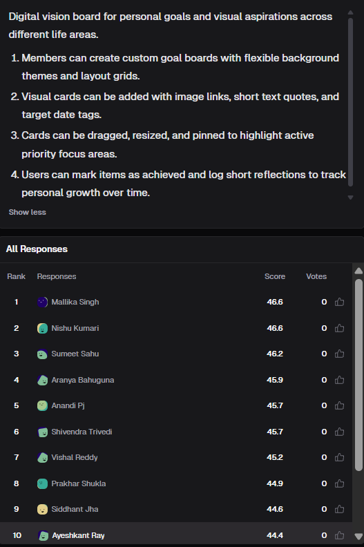
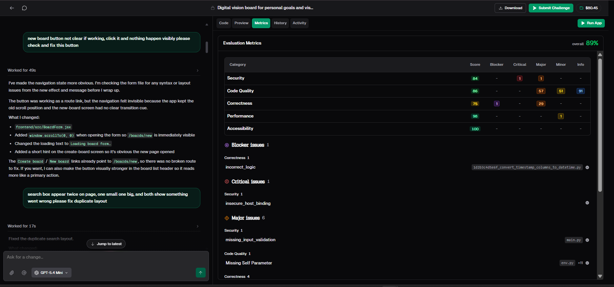

# Vibe Coding a Digital Vision Board: A Build Log, a Metrics Breakdown and What I Learned

*A case study from VibeCodeArena: turning a four-line product brief into a working app with AI, then finding out what an 89% score really means.*

## TL;DR

- The challenge was a **digital vision board** for personal goals: custom boards, visual cards, drag/resize/pin, and an "achieved" flow with reflections.
- I built and improved it with short, single-purpose prompts, using a lighter model (GPT-5.4 Mini) for focused fixes.
- The evaluation metrics gave the project **89% overall**, but one number hid a lot: **1 blocker, 1 critical issue and dozens of major issues**.
- The blocker was a correctness problem in a database migration. The critical issue was an insecure host binding. Neither was visible in the app itself.
- The lesson: a good prompt is a specification, a good fix is a small diff, and a good score still needs a human to read the findings underneath it.

## Table of Contents

1. [A thank you first](#1-a-thank-you-first)
2. [The challenge: a vision board in four requirements](#2-the-challenge-a-vision-board-in-four-requirements)
3. [Reading the brief like a developer](#3-reading-the-brief-like-a-developer)
4. [How I worked: small prompts, small diffs](#4-how-i-worked-small-prompts-small-diffs)
5. [Build log 1: the button that seemed to do nothing](#5-build-log-1-the-button-that-seemed-to-do-nothing)
6. [Build log 2: the search box that appeared twice](#6-build-log-2-the-search-box-that-appeared-twice)
7. [What these two fixes taught me about bug reports for AI](#7-what-these-two-fixes-taught-me-about-bug-reports-for-ai)
8. [The metrics: what 89% actually means](#8-the-metrics-what-89-actually-means)
9. [The blocker: a migration with incorrect logic](#9-the-blocker-a-migration-with-incorrect-logic)
10. [The critical issue: insecure host binding](#10-the-critical-issue-insecure-host-binding)
11. [Major issues and the problem of noise](#11-major-issues-and-the-problem-of-noise)
12. [Why a high score can still hide a serious problem](#12-why-a-high-score-can-still-hide-a-serious-problem)
13. [A test checklist for drag, resize and pin](#13-a-test-checklist-for-drag-resize-and-pin)
14. [Models, cost and choosing the right tool for each step](#14-models-cost-and-choosing-the-right-tool-for-each-step)
15. [Comparing with other solutions](#15-comparing-with-other-solutions)
16. [My fix list, in priority order](#16-my-fix-list-in-priority-order)
17. [Lessons for anyone building with AI](#17-lessons-for-anyone-building-with-ai)
18. [Conclusion](#18-conclusion)

## 1. A thank you first

I want to thank HackerEarth for giving me the chance to use VibeCodeArena. It was an exciting opportunity, and it taught me far more than I expected. I also want to thank Sreejith PV sir, who gave me this opportunity and guided me through it.

VibeCodeArena is a platform where you create projects with AI and browse what the community has built. Each project is scored by automated evaluation metrics, and the results are placed on a leaderboard. That combination of building, scoring and comparing turned out to be a very good way to learn how AI-generated code really behaves.

This repository is a case study of one project: a digital vision board. It is not a tutorial and it is not a product. It is an honest record of what I asked, what I got, what went wrong, and what the metrics told me.

## 2. The challenge: a vision board in four requirements

The brief for this challenge was:

> Digital vision board for personal goals and visual aspirations across different life areas.
>
> 1. Members can create custom goal boards with flexible background themes and layout grids.
> 2. Visual cards can be added with image links, short text quotes, and target date tags.
> 3. Cards can be dragged, resized, and pinned to highlight active priority focus areas.
> 4. Users can mark items as achieved and log short reflections to track personal growth over time.

It reads like a simple idea, but it contains four very different kinds of work:

- **Data modelling:** boards, themes, grids, cards, dates, achievements and reflections.
- **Content handling:** image links and text quotes, which come from users and cannot be trusted.
- **Interaction:** dragging, resizing and pinning, which are the hardest things to get right in a browser.
- **Progress over time:** achieved flags and reflections, which need sensible storage and ordering.

The project has a frontend written in JSX and a Python backend with database migrations, which is visible in the files the metrics point to. I improved it through follow-up prompts.

## 3. Reading the brief like a developer

Before writing any prompt, I tried to read the brief the way a reviewer would, asking what each sentence leaves undefined. This is the most useful habit I built during the whole exercise, so here is the exercise in full.

**"Custom goal boards with flexible background themes and layout grids."** How many themes? Are they fixed options or custom colours? What is a "layout grid": a number of columns, a snap-to-grid size, or both? Can a board's grid change after cards are placed?

**"Image links."** Links to where? Any URL? What happens when the link is broken, slow or points to something that is not an image? Is there a size limit?

**"Short text quotes."** How short? What happens with an empty quote, a very long one, or special characters?

**"Target date tags."** Can the date be in the past? Is it optional? What does the board show when a date passes and the item is not achieved?

**"Dragged, resized, and pinned."** Can cards overlap? Can they leave the board? What is the minimum size? How many cards can be pinned? Does pinning change position, order or only appearance?

**"Mark items as achieved and log short reflections."** Can an item be un-achieved? Can a reflection be edited or deleted? Is one reflection allowed per item or many over time?

None of these are answered by the brief, and every one of them will be answered by the AI whether or not I notice. That is the point. An AI will always fill a gap with a guess. If I do not decide, the model decides for me, and I only find out when something behaves strangely.

This list of questions became the backbone of my testing later, which I cover in section 13.

## 4. How I worked: small prompts, small diffs

I followed three rules.

**One problem per prompt.** In earlier experiments I used to stack five requests into one message. When something broke, I could not tell which change caused it. With one problem per prompt, a failure has exactly one place to hide.

**Describe what I see, not what I guess.** I wrote prompts the way a user would report a bug: what I clicked, what I expected and what happened.

**Read the explanation, not just the result.** After each fix, the model explains what it changed. I treated that explanation as part of the work. It tells me which files were touched and whether the model understood the real cause.

For focused fixes like these, I used a lighter model (GPT-5.4 Mini). I come back to that choice in section 14.

## 5. Build log 1: the button that seemed to do nothing

My first prompt in this round was:

> new board button not clear if working, click it and nothing happen visibly please check and fix this button

The model took 49 seconds. Here is the interesting part: it did not say "the button was broken." It said the button was working as a route link, but the navigation felt invisible. Two things caused that:

- the app kept the old scroll position after navigating, and
- the new board screen had no clear transition cue.

What it changed:

- In the board form component, it added a scroll-to-top call when the form opens, so the new page is immediately visible.
- It changed the loading text to "Loading board form..." so there is a visible state.
- It added a short hint on the create-board screen so it is obvious that a new page opened.

It also checked that both the "Create board" and "New board" links already pointed to the same new-board route, so there was no broken route to fix. And it offered to make the button visually stronger in the board list header as a follow-up.

I like this example because the bug I reported and the bug that existed were different. I described the symptom, "nothing happens," and the real cause was a feedback problem, not a logic problem. A model that blindly rewrote the button or the route could have broken something that worked.

## 6. Build log 2: the search box that appeared twice

My second prompt was:

> search box appear twice on page, one small one big, and both show something went wrong please fix duplicate layout

The model finished this in 17 seconds and reported that it fixed the duplicate search layout.

Notice what this bug report contains: the symptom (two search boxes), a detail (one small, one big), and a second symptom (both show an error). The extra details matter. "Both show something went wrong" suggests the duplicate may be a second component that is also failing, not just a layout problem. Details like that help a model, and they help me, because they point to where to look.

## 7. What these two fixes taught me about bug reports for AI

A good bug report for an AI is the same as a good bug report for a person.

1. **Say what you did.** "I clicked the New board button."
2. **Say what you expected.** "A new page should open."
3. **Say what happened.** "Nothing visible changed."
4. **Say where.** The page, the component or the screen.
5. **Add any detail that looks odd.** "One is small, one is big, and both show an error."

Prompts like "fix the button" or "it's broken" force the model to guess. The more specific the symptom, the more likely the model is to find the real cause, and in the first case above, the real cause was not what I assumed.

There is one more habit worth adding: **after the fix, test the original symptom and the neighbouring behaviour.** If the new-board page now scrolls to the top, does the board list still keep its scroll position when I go back? A fix can solve one problem and quietly create another next door.

## 8. The metrics: what 89% actually means

VibeCodeArena evaluates each project on five categories and lists findings by severity: blocker, critical, major, minor and info.

My project's **overall score was 89%**. Here is the category breakdown:

| Category | Score | Blocker | Critical | Major | Minor | Info |
|---|---|---|---|---|---|---|
| Security | 84 | - | 1 | 1 | - | - |
| Code Quality | 86 | - | - | 57 | 51 | 91 |
| Correctness | 75 | 1 | - | 29 | - | - |
| Performance | 98 | - | - | - | 1 | - |
| Accessibility | 100 | - | - | - | - | - |

A few things stand out.

**The categories tell different stories.** Accessibility is a perfect 100 and Performance is 98, but Correctness is only 75. An overall number averages those together and hides the weak spot.

**Correctness is the lowest score, and it is the only category with a blocker.** That is the category I would investigate first.

**Code quality has by far the most findings,** with 57 major, 51 minor and 91 info items. That is a lot of reading. Most of it will be repetitive, and the work is to find the few items that matter.

**Security is a high-looking 84, but it contains a critical issue.** A critical finding is more serious than its category score suggests.

## 9. The blocker: a migration with incorrect logic

The single blocker was a correctness finding labelled **incorrect_logic**, located in a database migration file whose name describes converting timestamp columns to datetime.

Why does this matter so much? Migrations are different from ordinary code. Ordinary code can be fixed and redeployed, and the worst case is usually a bad screen. A migration changes the structure of stored data. If the conversion logic is wrong, the possible outcomes include failing to run, corrupting values, or losing information, and some of those outcomes cannot be undone easily.

This is exactly the kind of problem that is invisible when you click around the app. The vision board looked and behaved fine in the preview. The danger sat in a file I would never open while testing the interface.

What I would do about it:

1. Read the migration carefully and understand what it converts, from what, to what.
2. Check how it handles empty values, time zones and existing rows.
3. Test it on a copy of the data, both upgrading and downgrading.
4. Only then ask the AI for a fix, with a precise description of the problem.

## 10. The critical issue: insecure host binding

The critical finding in the Security category was **insecure_host_binding**.

In general terms, this refers to a server being configured to listen on a network address more broadly than it should. That can be fine while developing, but it can expose a service to more of the network than intended once it runs somewhere shared or public.

I want to be careful here. The metrics screen tells me the category of the problem, not the exact line, and I would need to read the configuration to confirm how it applies to this project. The useful lesson is about process: the AI generated a setup that worked, and "works" is not the same as "is configured safely." Nobody asked the model to think about where the server should listen, so it picked something that makes the app run.

When I fix this, I would ask for a specific change: bind to the local address during development, and make the host a configuration value for deployment.

## 11. Major issues and the problem of noise

Beyond the blocker and the critical issue, the report listed dozens of major findings. Among the visible ones:

- **missing_input_validation** in the main backend file, a security finding. This is a familiar one: user input, such as a card quote, an image link or a reflection, must be checked before it is stored or used.
- **Missing Self Parameter**, a code quality finding in a migration environment file, with eleven more occurrences grouped under it.
- Several correctness findings.

Here is a point about triage. A report with hundreds of items is not a to-do list, it is a pile. Some findings are real defects, some are style, and some may be flagged in files that behave differently from normal application code. The "Missing Self Parameter" item, for example, appears in a migration configuration file, so I would want to check whether it matters there before spending time on it.

My triage order:

1. **Blockers and criticals first,** regardless of category score.
2. **Security majors second,** especially anything involving user input.
3. **Correctness majors third,** because they change what the app does.
4. **Code quality last,** and grouped, since many items share a cause.

The reason to be careful is that fixing 57 code quality findings feels productive but can distract from the one migration problem that could damage data.

## 12. Why a high score can still hide a serious problem

An overall score of 89% sounds comfortable. Here is why it should not make anyone relax.

**Scores are averages.** Many checks pass, which lifts the number, even when a single serious check fails.

**Severity and score are different scales.** A single blocker or critical finding can matter more than dozens of passing checks.

**Automated tools only find what they know to look for.** A clean category does not prove the code is right, only that those particular rules passed.

**AI code looks equally confident whether it is correct or not.** The generated code has tidy structure and sensible names. That polish can make a flawed migration or an unsafe setting feel trustworthy.

My own rule is now: read the findings first and the score last. Treat the score as a summary and the findings as the real information.

## 13. A test checklist for drag, resize and pin

The part of this project I would test most carefully is the interaction layer. These are the cases I wrote out from the brief in section 3.

**Boards and themes**
- Create a board with no name.
- Create two boards with the same name.
- Change the theme after cards already exist.
- Change the grid size with cards placed on it.

**Cards**
- Add a card with a broken image link.
- Add a link that does not point to an image.
- Add an empty quote and a very long quote.
- Use special characters and pasted markup in the quote.
- Set a target date in the past.

**Drag and resize**
- Drag a card outside the board edge.
- Drop one card exactly on top of another.
- Resize a card to the smallest and the largest possible size.
- Resize while another card is next to it.
- Drag on a small screen or with touch.

**Pinning**
- Pin one card, then pin many.
- Pin and unpin repeatedly and quickly.
- Check what pinning does to a card's position and order.

**Achieved and reflections**
- Mark an item achieved twice.
- Un-mark it, if allowed.
- Save an empty reflection and a very long one.
- Add several reflections to one item and check the order.
- Refresh the page in the middle of writing.

I did not run all of these cases, and I would not claim the project passes them. The value of writing them down is that every item is also a sentence I can put into a prompt. "Handle a broken image link by showing a placeholder" is a much better instruction than "make image cards work."

## 14. Models, cost and choosing the right tool for each step

I used a lighter model, GPT-5.4 Mini, for the focused fixes in this round. The two fixes above took 49 seconds and 17 seconds, which is quick enough that I could keep my attention on the problem.

What I have learned about models:

- **They differ in speed, care and confidence.** Some are fast but skip details. Some follow instructions closely. Some sound completely sure when they are wrong.
- **There is no single best model.** A lighter model is often enough for a small, well-described fix. A stronger one may be worth the wait for tricky logic, like a data migration.
- **Cost is about correct results, not requests.** A cheap model that needs five attempts can cost more in time and money than a stronger one that gets it right once.

Given what the metrics showed, I would not use a lighter model for the migration fix. A mistake there is expensive, so that is where I would pay for the more capable option and review the result myself.

## 15. Comparing with other solutions

The leaderboard for this challenge showed how tightly packed the results were. When I looked, the top score was 46.6 and I was in the top ten with 44.4. Between those two numbers sat a long list of builders with scores like 46.2, 45.9, 45.7 and 45.2.

When so many people start from the same brief and land within a few points of each other, the differences are in the details: how a migration is written, how input is validated and how carefully the server is configured. Those are the same details that my own metrics report flagged.

Comparison also teaches without scoring. Seeing other approaches to the same four requirements shows you decisions you did not think to make, like how others handled overlapping cards or past-due dates.

## 16. My fix list, in priority order

If I continued this project, this is the order I would work in, each item as its own prompt:

1. **Fix the migration logic (blocker).** Understand it first, test on a data copy, then ask for a precise fix.
2. **Make the host binding safe (critical).** Local binding in development and configuration-driven binding in deployment.
3. **Add input validation in the backend (major, security).** Quotes, image links, dates and reflections.
4. **Review the correctness majors.** There are 29, so group them by cause.
5. **Triage code quality findings.** Fix repeated patterns together and ignore noise only after checking it is noise.
6. **Add automated tests** for the card and board flows, so a future cleanup cannot quietly break something.
7. **Strengthen the new-board button** in the board list header, as the model itself suggested.

## 17. Lessons for anyone building with AI

1. **Treat the brief as a list of unanswered questions.** The AI will answer them for you if you don't.
2. **One problem per prompt.** Small changes are easy to check and easy to undo.
3. **Write bug reports like a good tester.** What I did, what I expected, what happened, and where.
4. **The reported bug and the real bug can differ.** Read the explanation to see whether the model found the actual cause.
5. **Read the findings before the score.** Blockers and criticals outrank everything else.
6. **Be extra careful with data and configuration.** Migrations and server settings are invisible in the interface and expensive when wrong.
7. **Triage noise deliberately.** Do not mistake a long list for a priority list.
8. **Match the model to the step.** A light model for small fixes, a stronger one for risky changes.
9. **Compare your work with others.** It shows you what you did not think to ask.
10. **Keep your fundamentals strong.** Without them, you cannot tell a good answer from a confident wrong one.

## 18. Conclusion

I started with a four-line brief and ended with a working vision board, an 89% score and a clear list of things that need fixing. The most valuable part was the gap between the first two of those: the app worked, and it still had a blocker, a critical issue and dozens of major findings underneath.

AI made the first draft cheap. What remained for me was specifying what the board should do, reading the model's explanations, triaging the metrics and deciding what to trust. That is the work that does not go away, and it is the part I want to get better at.

Thank you again to HackerEarth and to Sreejith PV sir for this opportunity. It was exciting, and I learned a lot.
findings underneath really mean.
